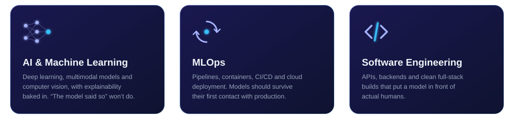
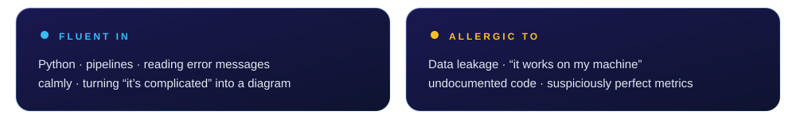

  

<i>Teaching machines to be right for the right reasons.</i>

  
  
  
  
  
  

B.Tech, Electronics &amp; Computer Science &nbsp;·&nbsp; KIIT University &nbsp;·&nbsp; Class of 2027

## Hello, I'm Adyasha

Electronics and Computer Science student at KIIT, part engineer, part storyteller, and allergic to doing things halfway. I build things that work, then explain them well enough that you might actually enjoy the documentation. (Rare, I know.)

Most of my time goes into **AI, machine learning and MLOps**, which means I spend a good chunk of it politely distrusting any metric that looks too good to be true. Outside the terminal I am a designer and writer at heart, so yes, this profile is dark and minimal on purpose. If something is going on the internet, it should have taste.

Always up for a good problem, a better idea, or any conversation that starts with "wait, what if..."

## What I focus on

## Featured work

<table>
  <tr>
    <td width="50%" valign="top">
      <h3><a href="https://github.com/adyashaexe/HardwareTrojanML">HardwareTrojanML</a></h3>
      <b>MAJOR PROJECT &nbsp;·&nbsp; MACHINE LEARNING × FPGA</b>
      
<i>Chips can hide things. Power draw cannot.</i>

      
Hardware Trojans are malicious modifications tucked inside chips, silent until a rare trigger fires. We catch them through physics instead of behaviour: extra logic draws extra power. An AES-128 core in Verilog, three Trojan variants, real measurements from a Basys3 FPGA, and Random Forest, SVM and 1D-CNN models deciding who is clean and who is lying.

      Verilog · Basys3 · INA219 · Arduino · PyTorch · scikit-learn
    </td>
    <td width="50%" valign="top">
      <h3><a href="https://github.com/adyashaexe/GastricSentinel">GastricSentinel</a></h3>
      <b>MINOR PROJECT &nbsp;·&nbsp; MULTIMODAL DEEP LEARNING</b>
      
<i>A prediction without an explanation is just an opinion.</i>

      
A full-stack web app for gastric cancer classification. Histopathology images, genomic profiles and clinical records meet in a fusion layer and leave as an 8-class prediction with a risk score. Every result comes with Grad-CAM heatmaps and SHAP values, plus a PDF report, because showing your work matters.

      PyTorch · Flask · Supabase · Grad-CAM · SHAP
    </td>
  </tr>
</table>

## The receipts

<table>
  <tr>
    <td width="190" valign="middle"><b>Languages</b></td>
    <td valign="middle">
      
      
      
      
      
    </td>
  </tr>
  <tr>
    <td valign="middle"><b>AI &amp; Machine Learning</b></td>
    <td valign="middle">
      
      
      
      
      
      
      
    </td>
  </tr>
  <tr>
    <td valign="middle"><b>Backend &amp; Frontend</b></td>
    <td valign="middle">
      
      
      
      
    </td>
  </tr>
  <tr>
    <td valign="middle"><b>Data &amp; Databases</b></td>
    <td valign="middle">
      
      
      
      
      
      
    </td>
  </tr>
  <tr>
    <td valign="middle"><b>MLOps, Cloud &amp; DevOps</b></td>
    <td valign="middle">
      
      
      
      
      
      
      
      
    </td>
  </tr>
  <tr>
    <td valign="middle"><b>Security &amp; Testing</b></td>
    <td valign="middle">
      
      
      
      
      
    </td>
  </tr>
  <tr>
    <td valign="middle"><b>Analytics &amp; Workflow</b></td>
    <td valign="middle">
      
      
      
      
      
      
      
      
    </td>
  </tr>
</table>

<b>The fine print (wider familiarity)</b>

 

SQL · REST APIs · Microservices · OOP · ETL · CI/CD · Computer Vision · Feature Engineering · Model Evaluation · SHAP · Grad-CAM · LLMs · RAG · LlamaIndex · FAISS · Statistical Analysis · Probability · Data Cleaning · Exploratory Analysis · Market &amp; Secondary Research · Requirements Gathering · Data-Driven Decisions · Report Writing · Stakeholder Communication

## Activity & consistency

  

## Strong opinions, loosely held

- **If I cannot explain it, it is not finished.** Working by accident does not count.
- **A notebook is not a product.** Deployment is where the truth comes out.
- **Treat models like software.** Versioned, tested, reproducible, monitored. Not a one-night experiment.
- **Accuracy needs a baseline.** Otherwise it is just a number with confidence.
- **Good code and a clear explanation of it are one skill.** Not two.

## Let's talk

Got a problem worth solving? Bring it, especially if it is messy. I am open to internships, collaborations, and a good conversation about AI, machine learning, MLOps, or building products that hold up outside the demo.

  

